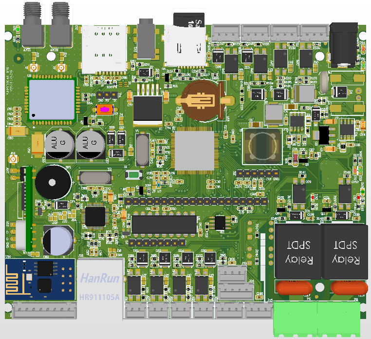
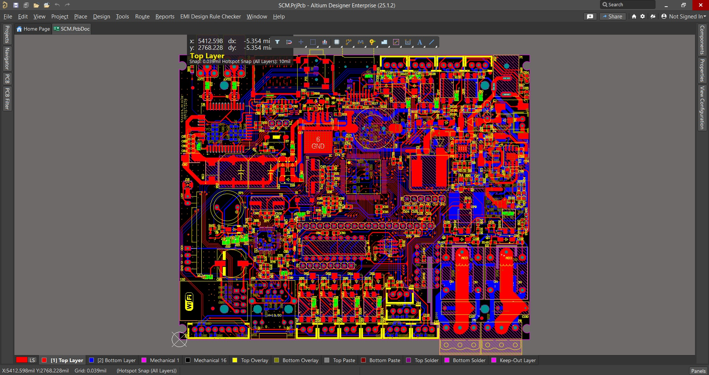
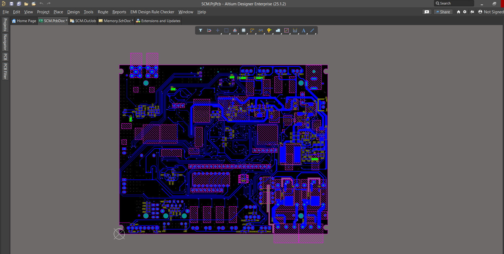
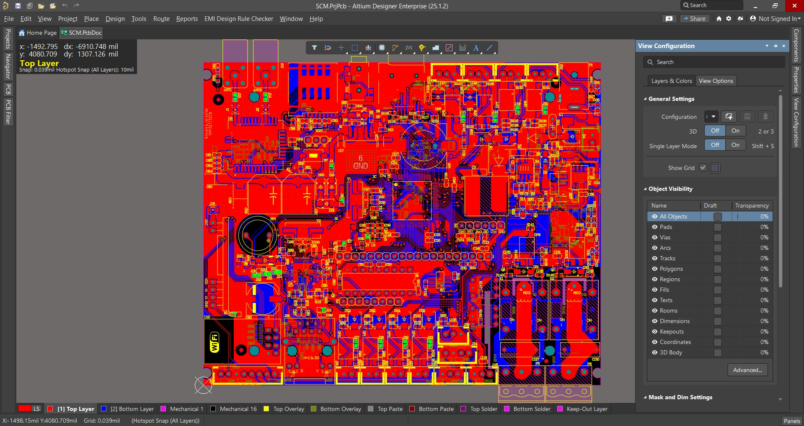
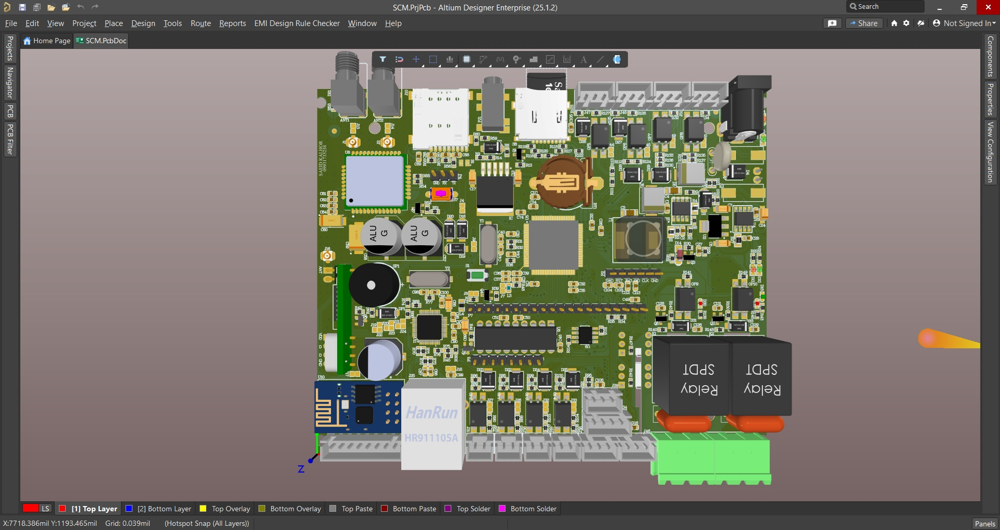
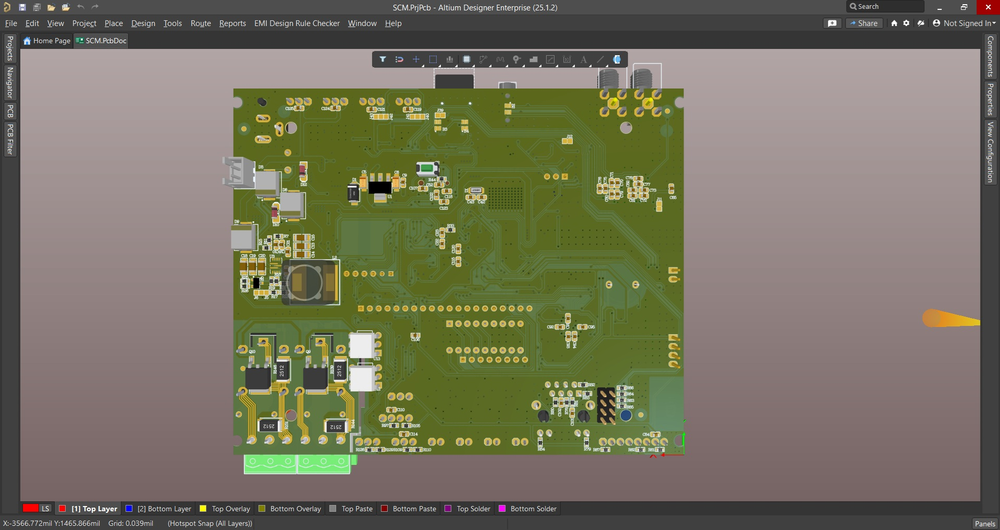

# STM32 Smart Monitoring & Control Board

  

## Overview

A high-density 2-layer embedded controller board designed around the STM32F103VCT6 microcontroller for industrial monitoring, remote control, and data acquisition applications.

The system integrates multiple communication interfaces including GSM, Ethernet, RF, and Wi-Fi, while supporting battery backup operation, sensor monitoring, data logging, and user interaction through LCD and keypad interfaces.

This project demonstrates mixed-signal PCB design, power management, communication subsystem integration, and high-density routing techniques using Altium Designer.

---

## Key Features

### Communication Interfaces

- GSM Communication (SIM800)
- Ethernet LAN Connectivity
- RF Wireless Communication
- Wi-Fi Client Connectivity

### User Interface

- LCD Display
- Matrix Keypad Interface
- Status Indicators

### Data Acquisition

- Digital Inputs
- Digital Outputs
- Analog Sensor Inputs
- Digital Sensor Interfaces

### Data Storage

- Micro SD Card Logging
- Event Storage Capability

### Power Management

- 12V DC Input
- Multi-Rail Power Architecture
- Reverse Polarity Protection
- Automatic Battery Backup Switching
- Power Failure Detection
- SMS Alert on Power Loss

---

## Hardware Architecture

### Main Controller

| Component | Description |
|------------|------------|
| MCU | STM32F103VCT6 |
| Core | ARM Cortex-M3 |
| Flash | 256 KB |
| Package | LQFP-100 |

### Communication Modules

| Module | Function |
|----------|----------|
| SIM800 | GSM/SMS Communication |
| Ethernet Interface | LAN Connectivity |
| RF Module | Wireless Communication |
| Wi-Fi Module | Client Connectivity |

### Peripherals

- LCD Display Interface
- Keypad Interface
- SD Card Interface
- Analog Sensor Inputs
- Digital I/O Expansion

---

## PCB Design Specifications

| Parameter | Value |
|------------|------------|
| PCB Layers | 2 |
| Design Tool | Altium Designer |
| PCB Type | Mixed Signal |
| Power Input | 12V DC |
| Ground Planes | Implemented |
| DRC Verification | Passed |

---

## Design Highlights

### Power Protection

The board includes reverse polarity protection circuitry to prevent hardware damage caused by incorrect power connection.

### Backup Power System

A dedicated battery backup subsystem automatically switches the device to backup power during mains failure, ensuring uninterrupted operation.

### Remote Notification

Power outage events can be reported remotely through GSM SMS notifications.

### High-Density Routing

The PCB incorporates:

- Mixed analog and digital circuitry
- Multiple communication interfaces
- High component density placement
- Optimized power distribution
- Ground plane implementation

---

## PCB Preview

### Top Layer

### Bottom Layer

### With Polygon

### 3D View

## Development Status

### Hardware

- [x] Schematic Design
- [x] PCB Layout
- [x] Design Rule Check (DRC)
- [x] 3D Verification
- [x] Manufacturing Outputs

### Firmware

- [ ] STM32 Firmware Development
- [ ] Peripheral Drivers
- [ ] GSM Stack
- [ ] Ethernet Stack
- [ ] Sensor Framework
- [ ] Data Logging System

---

## Skills Demonstrated

- Embedded Hardware Design
- PCB Layout Design
- Power Supply Design
- Protection Circuit Design
- Mixed-Signal PCB Routing
- STM32 Hardware Integration
- GSM Hardware Integration
- Ethernet Hardware Design
- RF Hardware Design
- Design Rule Verification
- Manufacturing Preparation

---

## Tools

- Altium Designer
- STM32 Platform
- SIM800 GSM Module

---

## Author 

Electronic Hardware Design Project

Designed and developed as an advanced embedded hardware and PCB design project focused on industrial monitoring and communication systems.

## Note

This project was developed as part of an advanced PCB design training program and further extended as a personal embedded systems project.

## Project Information

**Designer:** Saeid Kalhor

**Hardware Design Completion Date:** May 2026

**Status:** Hardware Design Completed, Firmware Development Planned 