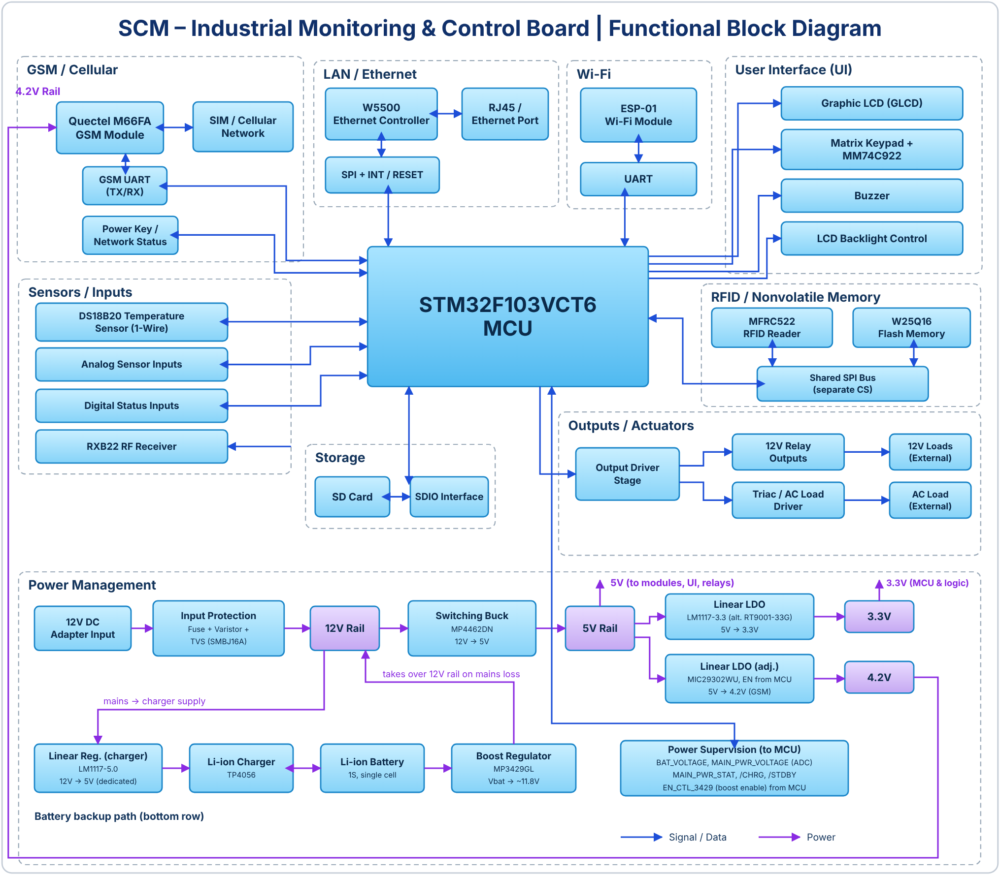

# STM32 Smart Monitoring & Control Board

A two-layer industrial monitoring and control board built around the **STM32F103VCT6**. GSM, Ethernet, Wi-Fi, SD logging, and a battery-backed power path, all designed in Altium Designer.

---

## Why I built this

I wanted one board of my own that brings together the things I keep running into on real products: several communication links, a messy power input, isolated field inputs, and a way to keep working when the mains drops.

This is that board. The hardware is finished. The firmware is what I'm working on next, and I'm doing it in the open, so the commit history will show the real progress (and the real mistakes).

---

## What's on the board

| Area | What's there |
|---|---|
| **MCU** | STM32F103VCT6 (Cortex-M3, 256 KB flash, LQFP-100), SWD header, 32.768 kHz crystal and coin-cell backup for the RTC |
| **Power in** | 12 V DC adapter jack with fuse, varistor, TVS diode (SMBJ16A) and reverse-polarity protection |
| **Power rails** | MP4462 switching buck (12 V to 5 V). 3.3 V from the 5 V rail through an LM1117-3.3 linear regulator (RT9001-33G as an alternate). 4.2 V for the GSM modem from the 5 V rail through an adjustable MIC29302 LDO that the MCU can enable and disable |
| **Battery backup** | Single-cell Li-ion. A TP4056 charges it once mains is back, powered from its own LM1117-5.0 linear regulator. An MP3429 boost converter lifts the battery to about 11.8 V and takes over the 12 V rail when the adapter drops out. The MCU reads battery voltage, mains voltage and a power-fail line, and can enable the boost stage |
| **Communication** | GSM modem (Quectel M66FA, SIM socket, U.FL antenna), Ethernet (WIZnet W5500 + RJ45, 10/100), Wi-Fi (ESP-01 socket), RXB22 RF receiver input, RFID reader header (MFRC522) |
| **Storage** | microSD card (SDIO) and a W25Q16 SPI NOR flash |
| **User interface** | Graphic LCD header (two chip-selects), matrix keypad with a hardware key encoder, push buttons, status LED, buzzer, LCD backlight control |
| **Inputs** | 8 optocoupler-isolated digital inputs, 2 analog inputs, 1-Wire header for DS18B20 temperature sensors, I²C header |
| **Outputs** | 2 relays and 2 triac outputs (driven through opto-triac drivers) |
| **Monitoring** | Battery voltage and main-supply voltage read through the ADC |

---

## Block diagram

  

Everything hangs off the STM32F103VCT6. Blue arrows are signals and data, purple arrows are power. The power section is worth a look: 12 V comes in through protection, a buck makes 5 V, and two linear regulators make 3.3 V and the GSM modem's 4.2 V from that 5 V. The battery path is separate. The charger has its own linear supply, and a boost converter feeds the 12 V rail when mains is lost. The RFID reader and the SPI flash share one SPI bus with separate chip-selects.

---

## PCB

Two layers, designed in Altium Designer, with ground planes on both sides. DRC passes, and the board has been taken through to manufacturing outputs.

| Top layer | Bottom layer |
|---|---|
|  |  |

| With polygon pours | 3D view (top) | 3D view (bottom) |
|---|---|---|
|  |  |  |

---

## Design notes

A few decisions worth explaining, since they're the parts I thought about most:

- **The GSM modem gets its own 4.2 V rail.** GSM modules pull current in short bursts when they transmit, so I gave this one a dedicated regulator and a lot of bulk capacitance instead of sharing the 3.3 V rail with the MCU.
- **Field inputs are optocoupler-isolated.** A noisy sensor cable shouldn't be able to reach the MCU pins directly.
- **Mains-side outputs are isolated too.** The triacs are driven through opto-triac drivers, not straight from GPIO.
- **Power loss is a normal event, not an error.** The board detects the drop, switches to the battery, and is meant to send an SMS about it. That last part is firmware, so it isn't done yet.

### Ideas for the next revision

These are things I'd change, not things I've done:

- Move to a 4-layer stack-up for cleaner return paths and easier routing around the Ethernet and RF sections.
- Add an RS-485 transceiver, so Modbus can run on this board without an external converter.
- Add proper test points on the main rails and the comms lines.

---

## Firmware plan

Nothing is flashed yet. Here's how I'm going to approach it:

1. **Write portable code first.** Every pin, port and clock setting lives in one `board_config.h` as `#define`s. I bring each peripheral up on a Blue Pill, then port it to this board by changing the names in that one file.
2. **Bare-metal first (v1.0), RTOS second (v2.0).** I want a working version I fully understand before I put FreeRTOS under it.
3. **Test what the Blue Pill can't on the real board.** It has no SDIO, for example, so the SD card will be tested here directly.

### Progress

**Hardware**
- [x] Schematic
- [x] PCB layout
- [x] DRC
- [x] 3D check
- [x] Manufacturing outputs

**Documentation**
- [ ] Block diagram and design notes in `docs/`
- [ ] Pin map (signal names only) in `docs/`

### Firmware roadmap

The firmware is **in progress**. I work in two-week sprints, one block per sprint, and I update this table at the end of each one. Each block is first written and tested on a Blue Pill, then moved to this board.

Status key: ✅ done · 🔄 in progress · ⏳ planned

| Sprint | Block | Status | Notes |
|---|---|---|---|
| 1 | Repo structure, `board_config.h`, bring-up (clock, SWD, LED) | 🔄 | Started |
| 2 | Timebase, buzzer, relays, 1-Wire | ⏳ | |
| 3 | LCD and keypad | ⏳ | |
| 4 | ADC: inputs, battery and main voltage | ⏳ | |
| 5 | RTC with battery backup, power-fail detection | ⏳ | |
| 6 | UART with DMA, GSM (AT commands, SMS) | ⏳ | |
| 7 | Wi-Fi (ESP-01) and I²C sensors | ⏳ | |
| 8 | SPI: NOR flash and RFID | ⏳ | |
| 9 | SD card logging (SDIO + FatFs) | ⏳ | Needs the real board, the Blue Pill has no SDIO |
| 10 | Ethernet (W5500) and MQTT | ⏳ | |
| 11 | **v1.0:** everything running bare-metal | ⏳ | |
| 12+ | **v2.0:** same firmware redesigned on FreeRTOS | ⏳ | |

Last updated: *(fill in the date each sprint)*

---

## Repository layout

Already in the repo:

| Path | What's in it |
|---|---|
| `Images/` | Board renders, layout screenshots and the block diagram |
| `README.md` | This file |

Coming as the project moves forward:

| Path | What will be in it |
|---|---|
| `docs/` | Block diagram, design notes, pin map |
| `firmware/` | Source code, with `board_config.h` |

---

## Getting the files

- **Hardware files:** the schematic, layout and manufacturing files are not published. I'm keeping them private. If you're a potential employer or collaborator and would like to go through the design, get in touch and I'll walk you through it.
- **Firmware:** nothing to build yet. The first tagged firmware release will be v1.0.

---

## Feedback

If you spot something wrong in the schematic or the layout, please open an issue. I'd much rather hear it now than after the next revision.

---

## About me

I'm Saeed Kalhor, an electronics engineer working on embedded systems and PCB design. I'm building my career toward embedded systems engineering in the automotive industry, and this board is the project I'm using to get there.

**Background**
- B.Sc. in Electrical Engineering, Bu-Ali Sina University (2014–2018)
- M.Sc. in Electronics, Shahid Beheshti University. My focus was analog integrated circuits, and my thesis was *Design and Simulation of an Improved Linear Operational Transconductance Amplifier (OTA) for Biomedical Applications*.

**Work**
Since late 2023 I've been part of the R&D team at Tika Precision Industry Engineering Co. in Tehran, working as a hardware designer and test engineer.
- I design electronic hardware and PCBs, and I work closely with the software team so that hardware and firmware come together on the first bring-up.
- I test and debug devices on the bench: PCB inspection, hardware troubleshooting, power rails and communication buses.
- I program and deploy firmware on the boards we build.
- I also work with a small freelance team on electronics projects.

**What I do**
- Design PCBs in Altium Designer, from schematic and component selection through layout and manufacturing files. This board is a two-layer design with a mixed power path (switching buck, linear regulators, battery backup), several communication interfaces and isolated field inputs.
- Write STM32 firmware in C, using CubeMX, Keil and bare-metal drivers.
- Find out what goes wrong when a design meets real hardware, and fix it.

**What I'm working on now**
- Writing the firmware for this board, one block at a time, in two-week sprints. The plan is bare-metal first, then a FreeRTOS version.
- Learning the parts of automotive embedded work I don't have yet: CAN, UDS, and the standards around MISRA C, AUTOSAR and ISO 26262.
- Designing an 8-layer board, using high-speed layout guidelines, for a 5G modem project.

**Why I'm sharing this**
I'd rather show real work, including the unfinished parts, than a polished list of claims. The progress table above is updated as I go.

If you're hiring for embedded or hardware roles, or you'd like to talk about this design, I'd be glad to hear from you.

- GitHub: [saeidk95](https://github.com/saeidk95)
- LinkedIn: [Saeed Kalhor](https://www.linkedin.com/in/saeed-kalhour-31545824a)

## License

All rights reserved. The firmware will get an open-source license when the first release is ready. The hardware design (schematic, layout, manufacturing files) is not licensed for copying or reuse.

---

## Changelog

### Unreleased
- Rewrote the README: feature table, block diagram (power section redrawn to match the schematic), design notes, firmware plan and progress checklist.

### Hardware v0.1.0 (date: fill in)
- First complete hardware design: schematic, 2-layer PCB, DRC, manufacturing outputs.

<!--
راهنمای به‌روزرسانی README، مرحله به مرحله (این بخش در گیت‌هاب دیده نمی‌شود؛ بعد از اتمام کار می‌توانی پاکش کنی)

قاعده کلی: هر مرحله یک کامیت جدا. فقط همان بخش‌هایی را که در مرحله گفته شده عوض کن، و در انتها یک خط به Changelog اضافه کن.

مرحله ۰: قبل از اولین انتشار، این موارد را چک کن
 - نام: در ریپوی قبلی Saeid بود و در رزومه Saeed. یکی را انتخاب کن و همه‌جا یکسان بنویس.
 - تاریخ: در README قبلی مه ۲۰۲۶ بود و در رزومه آذر ۱۴۰۴ تا فروردین ۱۴۰۵. تاریخ واقعی را در Changelog (خط Hardware v0.1.0) بنویس.
 - مدل GSM: README قبلی SIM800 می‌گفت ولی شماتیک و بلوک‌دیاگرام ماژول Quectel M66FA را نشان می‌دهد و در README همین نوشته شده.
 - عکس بلوک‌دیاگرام: فایل Block_Diagram.png را در پوشه Images آپلود کن (هم‌نام و با همین حروف بزرگ/کوچک). بدون آن عکس در README نمایش داده نمی‌شود. عکس جدید با مدل M66FA، املای درست Cellular و بخش تغذیه‌ی اصلاح‌شده بازسازی شده است. اگر بعداً بخش تغذیه تغییر کرد، هم عکس و هم ردیف‌های Power in / Power rails / Battery backup را به‌روز کن.
 - ردیف Power in را با شماتیک مطابقت بده (فیوز، وریستور، TVS، حفاظت معکوس).
 - بخش «Ideas for the next revision» ایده‌های پیشنهادی است؛ هرکدام را که قبول نداری حذف کن.
 کامیت پیشنهادی: docs: fix author name and verify hardware facts

مرحله ۱: تنظیمات ریپو (بدون تغییر در README)
 - Description یک‌خطی بگذار، مثلاً: STM32F103 industrial monitoring and control board (Altium, 2-layer)
 - Topics: stm32, stm32f103, altium-designer, pcb-design, embedded, industrial-automation, gsm, ethernet
 - ریپو را در پروفایل Pin کن.

مرحله ۲: مستندات (بدون انتشار فایل‌های طراحی)
 - تصمیم: شماتیک، BOM، فایل Altium و Gerber منتشر نمی‌شوند.
 - پوشه docs/ بساز و فقط این‌ها را بگذار: عکس بلوک‌دیاگرام (کپی از Images)، design-notes.md (توضیح تصمیم‌های طراحی)، و pinout.md که فقط نام سیگنال به پایه MCU را دارد (مثلاً LAN_SCK ← PA5)، بدون اتصال قطعات و مقدار المان‌ها.
 - در README در بخش Progress، دو مورد Documentation را هرکدام که آپلود کردی تیک بزن.
 - کامیت پیشنهادی: docs: add block diagram and pin map

مرحله ۳: دسترسی کنترل‌شده به طراحی
 - برای مصاحبه یا کارفرما، شماتیک را فقط وقتی خواستند بفرست (PDF بدون Altium). اگر خواستی، نسخه‌ی watermark دار بساز.
 - در README چیزی لازم نیست عوض شود؛ جمله‌ی Getting the files همین را می‌گوید.
 - اگر عکس‌های لایه Top/Bottom را هم نمی‌خواهی کامل دیده شوند، بعداً آن‌ها را با نسخه‌ی کم‌وضوح یا فقط 3D عوض کن.

مرحله ۴: فریمور (جدول Firmware roadmap، هر دو هفته یک سطر)
 - ریتم: هر دو هفته (یک اسپرینت) فقط یک ردیف جدول را به‌روز کن. با ۸ ساعت یادگیری در هفته، هر اسپرینت حدود ۱۶ ساعت است.
 - شروع اسپرینت: وضعیت ردیف را ⏳ به 🔄 تغییر بده. پایان اسپرینت: 🔄 را ✅ کن و ردیف بعدی را 🔄 کن.
 - ستون Notes: یک جمله‌ی صادقانه بنویس (چه یاد گرفتی، چه اشتباهی کردی، لینک ویدئوی کوتاه تست).
 - خط «Last updated» را با تاریخ همان روز عوض کن.
 - اولین بار: پوشه firmware/ و فایل board_config.h را بساز (دو پروفایل Blue Pill و برد) و در Repository layout پوشه‌ی firmware را از «planned» به لیست اصلی ببر.
 - بج فریمور فعلاً in progress (زرد) است. وقتی v1.0 تمام شد، in%20progress-yellow را به v1.0-brightgreen عوض کن.
 - کامیت پیشنهادی: docs: update firmware roadmap, sprint N (و کد: feat(firmware): add LCD driver)

مرحله ۵ به بعد: هر ماژول که کارش تمام شد (دقیقاً به ترتیب فاز A برنامه اکسل)
 - در جدول Firmware roadmap وضعیت همان ردیف را ✅ کن.
 - اگر چیز جالبی یاد گرفتی یا اشتباهی کردی، یک خط کوتاه زیر همان مورد بنویس. این خط‌ها لحن واقعی کار را نشان می‌دهند.
 - اگر ویدئوی کوتاهی از تست روی برد داری، لینکش را کنار همان مورد بگذار.
 - یک خط به Unreleased در Changelog اضافه کن.
 - کامیت پیشنهادی: feat(firmware): add LCD driver (یا RTC، ADC، ...)

مرحله ۶: نسخه v1.0 بدون RTOS
 - وقتی همه موارد تا Ethernet و MQTT تیک خوردند و یکپارچه‌سازی تمام شد: مورد v1.0 را تیک بزن.
 - یک Release با تگ fw-v1.0.0 بساز و در Changelog یک بخش جدید با تاریخ بنویس.
 - بج فریمور را به نسخه v1.0 تغییر بده.

مرحله ۷: نسخه v2.0 با FreeRTOS
 - مورد v2.0 را تیک بزن، یک بخش کوتاه به نام Firmware architecture اضافه کن (لیست تسک‌ها و اولویت‌ها)، تگ fw-v2.0.0 و ورودی Changelog.

مرحله ۸: نسخه بعدی برد (۴ لایه)
 - یک بخش جدید Rev B بساز، موارد «Ideas for the next revision» را به Checklist تبدیل کن، (فایل‌های طراحی Rev B هم منتشر نمی‌شوند).

قالب ورودی Changelog:
 ### fw v1.0.0 (YYYY-MM-DD)
 - Added: ...
 - Fixed: ...
-->
